# pt

<picture>
  <source media="(prefers-color-scheme: dark)" srcset="assets/readme/experiencepoint-white.png">
  
</picture>


A product testing space for simple, temporary, client-facing assets and tools, published via GitHub Pages.

There is no homepage at the repo root by design. Each project lives in its own folder and is published at its own URL. Each card opens the live page.

### Live tools

<a href="https://ep.github.io/pt/field-tools/room-pulse/"></a>
<a href="https://ep.github.io/pt/field-tools/pair-poll/"></a>
<a href="https://ep.github.io/pt/field-tools/chips/"></a>

### Workshop companions

<a href="https://ep.github.io/pt/wbwai201/report-builder/"></a>
<a href="https://ep.github.io/pt/kc/report-builder/"></a>
<a href="https://ep.github.io/pt/agents/"></a>
<a href="https://ep.github.io/pt/ai-champion-charter/"></a>

### Partner hubs

<a href="https://ep.github.io/pt/kc/"></a>
<a href="https://ep.github.io/pt/wbwai201/"></a>
<a href="https://ep.github.io/pt/podium-for-partners/"></a>

### Design ideas

<a href="https://ep.github.io/pt/design-ideas/room-pulse/"></a>
<a href="https://ep.github.io/pt/design-ideas/clear-instructions/"></a>
<a href="https://ep.github.io/pt/design-ideas/wbwai-ai-guide/"></a>
<a href="https://ep.github.io/pt/design-ideas/wbwai-icebreakers/"></a>

Every project, as a list

- https://ep.github.io/pt/field-tools/room-pulse/ : Room Pulse, a live emotional check-in at the start and end of a session, which can also play saved results over time (field tool).
- https://ep.github.io/pt/pulse/ : the short address participants type to join a pulse (forwards to Room Pulse's join screen).
- https://ep.github.io/pt/field-tools/pair-poll/ : Pair Poll, a live paired-statement poll for workshops (field tool).
- https://ep.github.io/pt/join/ : the short address participants type to join a poll (forwards to Pair Poll's join screen).
- https://ep.github.io/pt/field-tools/chips/ : Place Your Chips, a live prioritization game (field tool).
- https://ep.github.io/pt/field-tools/ai-impact-ladder/ : AI Impact Ladder, a guided conversation about measuring AI adoption and its impact, ending with a plan to share (field tool).
- https://ep.github.io/pt/field-tools/reimagination-lab/ : Reimagination Lab, rethink one workflow in a single sitting, as a team on one shared screen or on your own (field tool).
- https://ep.github.io/pt/wbwai201/report-builder/ : Turn the CSV export from WBWAI 201 into a sponsor-ready report.
- https://ep.github.io/pt/kc/report-builder/ : Turn the CSV export from KickstartChange into a team-by-team report.
- https://ep.github.io/pt/agents/ : Create Your First Agent. Companion activity for Work Better with AI 201.
- https://ep.github.io/pt/ai-champion-charter/ : Interactive tool to help sponsors draft AI champion charters.
- https://ep.github.io/pt/kc/ : KickstartChange partner enablement hub.
- https://ep.github.io/pt/wbwai201/ : Work Better with AI 201 partner enablement hub.
- https://ep.github.io/pt/podium-for-partners/ : Positioning Podium with IP-holder partner prospects.
- https://ep.github.io/pt/podium-for-partners-ideo/ : Positioning Podium, IDEO version.
- https://ep.github.io/pt/design-ideas/room-pulse/ : Podium pulse activity interaction, reveal, and design ideas.
- https://ep.github.io/pt/design-ideas/wbwai-ai-guide/ : Working with AI sketchbook, five design directions for a double-sided guide to working with AI, for Work Better with AI 201 participants and facilitators.
- https://ep.github.io/pt/design-ideas/wbwai-icebreakers/ : Icebreaker sketchbook, nine team-forming mechanics for open enrollment workshops, three of them playable.
- https://ep.github.io/pt/design-ideas/clear-instructions/ : Clear Instructions sketchbook, design ideas for activity instructions nobody can misread: who you're with, where you work, and when to type in the workshop app (built from the WBWAI 201 activities).
- https://ep.github.io/pt/Logistics/EC/In-Person/ : Support's experimental logistics checklist.
- https://ep.github.io/pt/t3/wbwai-curveballroleplay/ : Experimental T3 artefact: WBWAI Curveball Roleplay.
- https://ep.github.io/pt/t3/wbwai-prepskillbuilder/ : Experimental T3 artefact: WBWAI Prep Skill Builder.
- https://ep.github.io/pt/webinars/reimagine-with-ai/ : Reimagine with AI webinar survey results (totals only).
- https://ep.github.io/pt/feedback/ : Feedback board, where the team reads tester comments on any tool, grouped by its parts, and copies them for an AI (needs the team key).

## How it works

Pages deploys from the root of `main`. Any folder with an `index.html` is published at `https://ep.github.io/pt/<folder>/`. The empty `.nojekyll` file stops Pages from rendering this README as a root homepage, so `https://ep.github.io/pt/` returns 404 on purpose.

Folder conventions: interactive field tools (games, diagnostics, workshop tools) live under `field-tools/`, one folder per tool. Design sketchbooks (a cover page plus live concept pages, with screenshot thumbnails in a `thumbs/` folder) live under `design-ideas/`, one folder per sketchbook. Other kinds of test tools get their own top-level folders. Shared assets that more than one project uses (the favicon set and the kits below) live under `assets/`; a page links them by absolute path, `/pt/assets/favicon/favicon.svg`. The cards at the top of this README live in `assets/readme/`, one SVG each, with their words drawn as shapes so they look the same on every screen. To add or change a card, edit `assets/readme/build/build.py` and run it; the note at the top of that file lists what to install.

Two shared kits live in `assets/kit/`, each switched on by one line in a page. The feedback kit (`feedback.js`) lets testers comment on any tool: they open it with their tester link, which ends in `?feedback=` and a code, click Comment, click the area of the page they mean, and post. Comments go to the backend below with the screen, the settings and the device, and no picture is taken. Without `?feedback` the kit does nothing. The team reads comments on the feedback board at `ep.github.io/pt/feedback/`, which needs the team key: comments are grouped by the parts of each tool, each screen is rebuilt from the tool's own code, and comments on an earlier version of a tool stay out of what is copied for an AI unless the team marks them still open. The Email this kit (`send.js`) lets people email a tool's output from their own email. How to add, set up and remove each kit is in the comment at the top of its file.

To add a project: create a folder, add an `index.html`, commit. Add it to the list under Every project too; a card is optional. 

Add `<meta name="robots" content="noindex, nofollow">` inside `<head>` to prevent compliant crawlers (Google, Bing, etc.) from indexing the page or following its links. 

## Two things to know before committing anything

1. Everything in this repo is public twice: browsable here on GitHub, and served as a live page at the Pages URL. That includes this README and the `_backend` folder. Never commit client-sensitive content, internal strategy, or anything you would not put on the open internet.
2. Never commit secrets. No API keys, no passwords, not even briefly to test something. The moment a secret touches a public repo, treat it as leaked. Secrets live only as Cloudflare dashboard secrets or as GitHub Actions secrets, never in a file.

## The backend

Static pages cannot remember anything or keep a secret, so tools that need shared live state (like Place Your Chips) talk to a small server we run on Cloudflare: a Worker named `pt` with a D1 database, also named `pt`. One backend serves every tool in this repo; each tool identifies itself with a short id, so their data never mixes.

- The source of truth for the worker is this repo: `_backend/pt-worker.js` is the code and `_backend/wrangler.toml` is the configuration (name, database binding, cron trigger). Deploys are automatic: when a change under `_backend/` lands on `main`, GitHub Actions runs every test suite and, only if all pass, deploys with wrangler. Nobody edits the worker in the Cloudflare dashboard; a dashboard edit is overwritten by the next push.
- Tests live in `_backend/tests/` and run on every push and pull request. See `_backend/tests/README.md` to run them locally.
- Some tools are gated: every session has a key, generated when a facilitator starts it. In a closed session (Place Your Chips) the key rides inside the join link, so participants click and never type, and nobody without the link can touch the session. In an open session (Pair Poll, Room Pulse) the facilitator keeps the key and participants join with a four-letter code instead, by typing it, tapping a link, or scanning a QR; the code lets them read the session and write only the paths the tool opened (ballots, a roster, a presence heartbeat), never anything else. Because a four-letter code can be guessed by machine, a tool only opens paths whose contents are harmless to a stranger: anonymous votes yes, notes about colleagues no. The list of gated tools is the `GATED_TOOLS_DEFAULT` line near the top of the worker file. Tools handling anything sensitive belong on that list, as closed sessions.
- Session data is temporary by design. Ending a session deletes it immediately, and a daily sweep deletes anything untouched for 7 days. Nothing in the backend is an archive; if a session produced something worth keeping, download the report. Feedback comments are the one exception: each stays a year after it last changed, so the team can compare comments across versions of a tool.

## Adding a tool that needs the backend

Pick a short id for the tool (letters, numbers, hyphens, like `pyc`), point the tool at the worker URL, and send that id with every request. If the tool will hold sensitive content, add its id to `GATED_TOOLS_DEFAULT` in `_backend/pt-worker.js` and commit; the deploy is automatic. Decide whether its sessions are closed (key in the join link) or open (code to join, key stays with the facilitator, only harmless paths writable by code); the worker header comment explains both. If you are unsure whether a tool needs the backend at all, it probably does not: pages that only display things need nothing.
